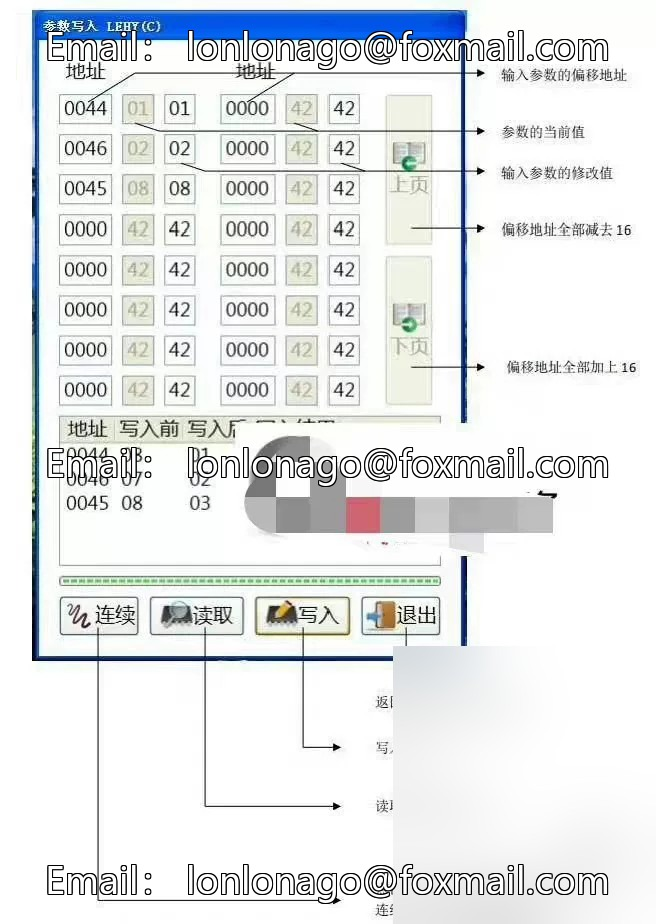
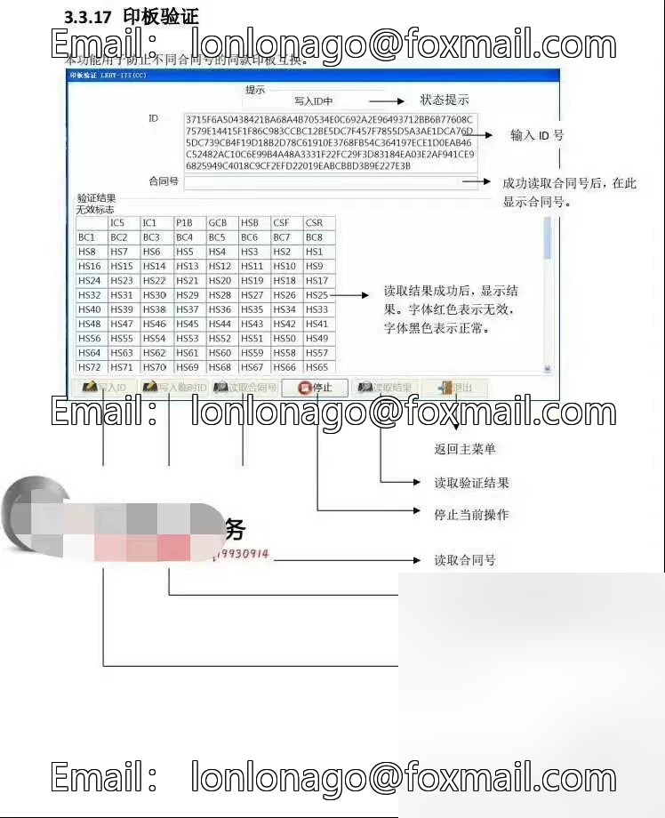
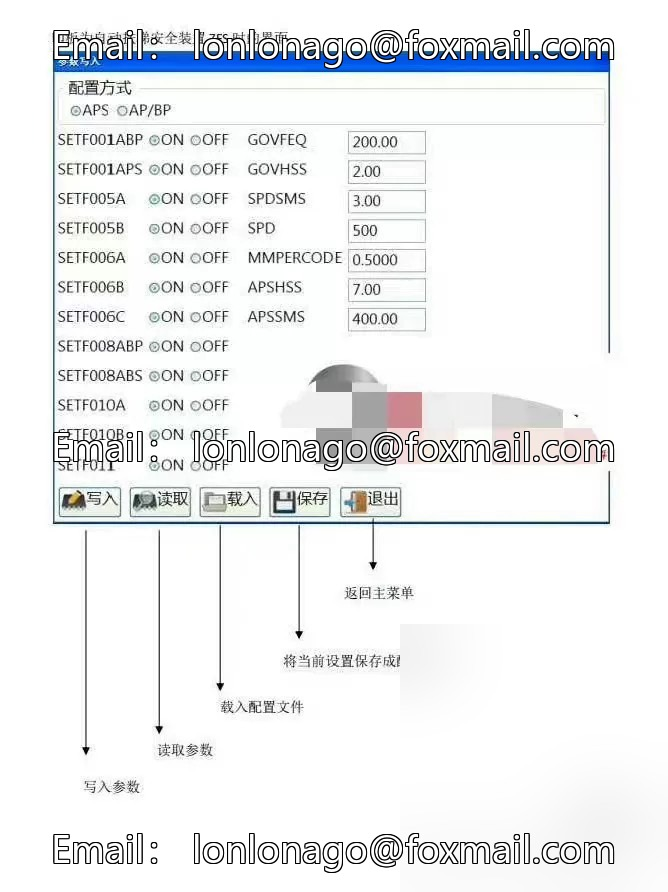
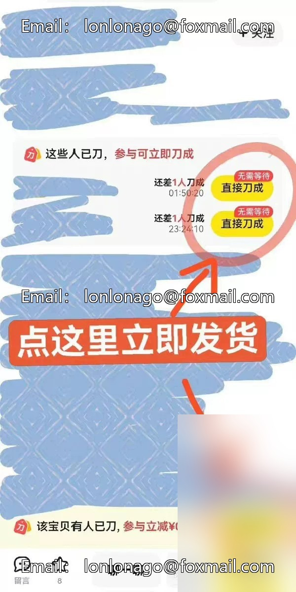

# Mitsubishi 2nd generation MC card usage manual, over 100 pages of content, for those without a card.

## Body

Mitsubishi 2nd generation MC card usage manual, over 100 pages of content. Brothers without cards can also start learning from this guide. The content is rich and mastering this manual will undoubtedly make you a Mitsubishi expert.
Introduction as follows
1. Introduction to the connection of various interfaces in MTI cards
2. Introduction to the steps for parameter reading and writing with text and images
3. MTI Card Various Functions with Text and Images, such as Operational State, Section Address Explanation, ETS Testing, Layer Display Detection, Abnormal Signal Reading, Section Address Write Mode, Address Variables, Steps for Parameter Writing Teaching, Plate Verification with Text and Images, Fault Recording, Driver Data Tracking Introduction, MC Card Fault Troubleshooting Mode

## Images

## Payment

Here is a pay link on Stripe ( https://buy.stripe.com/3cs8yP7sY87d0vu9AB ). Please contact me lonlonago@foxmail.com after funding $89, and I will send you a complete data files , thank you!

